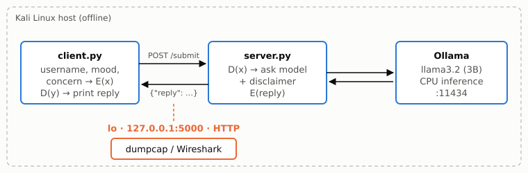

National University of Computer and Emerging Sciences (FAST–NUCES)

<h1 class="title">Breaking PsycoSupport</h1>

Offline deployment, loopback interception and Al-Kindi cryptanalysis of an affine-encrypted LLM support app

Information Security · Assignment #1 · Fall 2026

<strong>Muhammad Rafique</strong> · Roll No. 23i-0747

21 October 2026

Repository: <a href="https://github.com/Rafique610/psycosupport-cryptanalysis">github.com/Rafique610/psycosupport-cryptanalysis</a>

# Introduction

PsycoSupport is a local mental-health support tool: a patient enters a username, a mood and a concern; a
server asks a local LLM (Ollama, `llama3.2`) for supportive advice; both directions are "protected" with an
affine cipher. This report deploys the app fully offline (Task 1), intercepts its loopback traffic (Task 2),
recovers the key and decrypts every session using only the intercepted ciphertext (Task 3), and analyses the
security failures with proper alternatives (Task 4).

All results come from real runs on 21 October 2026 and are reproducible with the commands in the Appendix.
