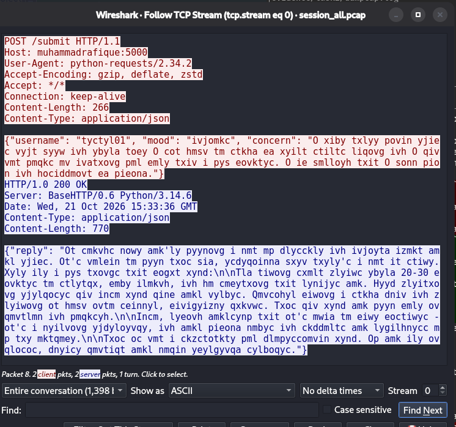
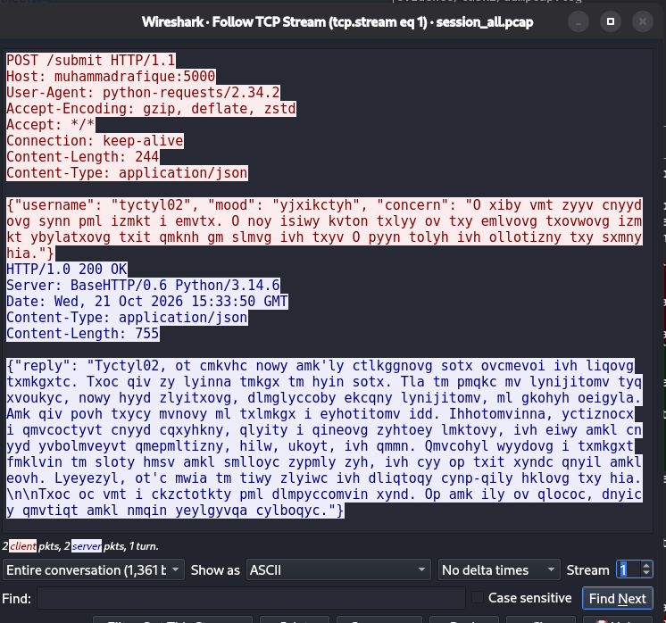
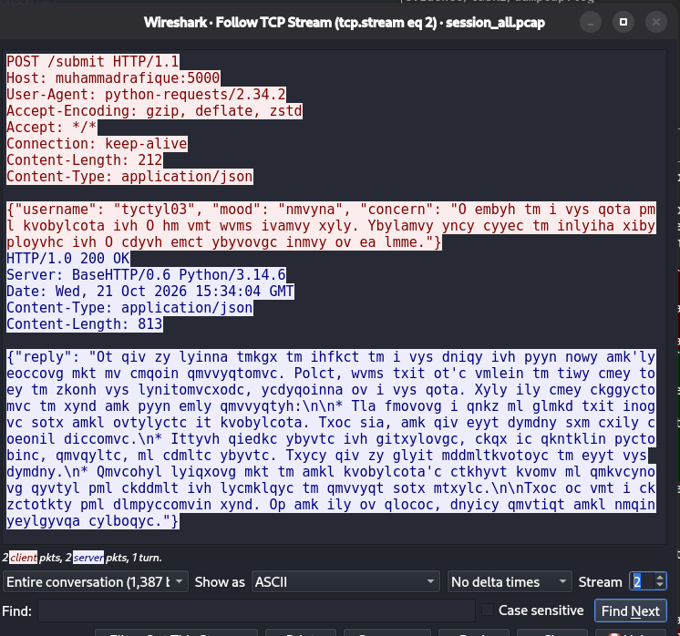
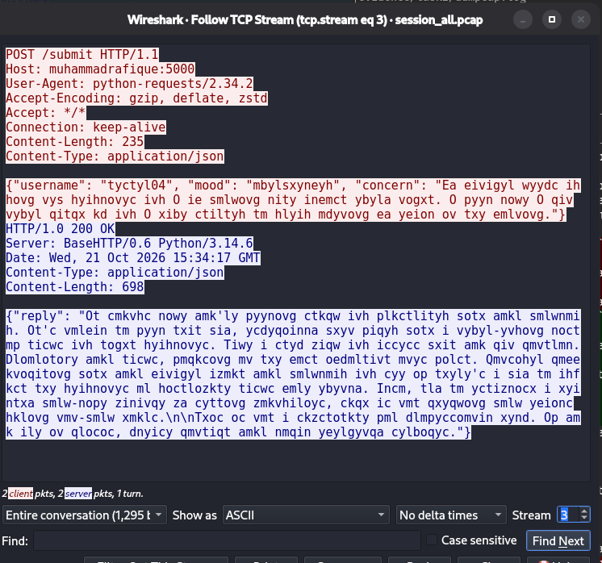
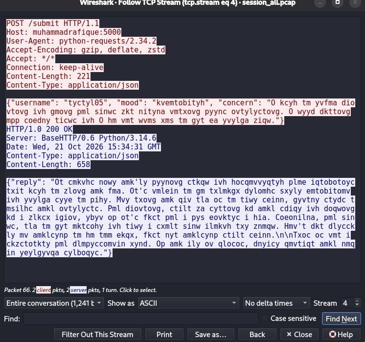

# 2. Local Network Traffic Interception

## 2.1 Setup

- Client and server run on the same Kali machine. The client connects to `http://muhammadrafique:5000`
  (the brief's "host file" name, mapped to `127.0.0.1` in `/etc/hosts`), so every byte crosses the
  loopback interface `lo` only.
- Capture tool: `dumpcap` (Wireshark's capture engine), run as a non-root member of the `wireshark` group:

  ```bash
  dumpcap -i lo -f "tcp port 5000" -w evidence/task2/session_all.pcap   # task capture
  ```

  Capture filter `tcp port 5000`; in Wireshark the matching display filter is `tcp.port == 5000`.
- The five test cases (`scripts/capture/test_cases.csv`) were fed to the real `client.py` by
  `scripts/capture/run_cases.py` (`task run-cases`), with a 5-second pause between sessions so each
  becomes a separate TCP stream.
- Capture window: 21 October 2026, 8:33:25 to 8:34:36 PM (UTC+05:00 · 15:33:25 to 15:34:36 UTC).
  Result: 70 packets, 0 dropped, 14.1 KB (`evidence/task2/session_all.pcap`). The file is small enough to
  ship whole, so no `editcap` trimming was needed.

The model ran on the CPU for this capture: a first attempt on the RTX 3050 failed when the open-source
nouveau driver timed out (`job timeout, channel 4 killed`), so `server.py` now requests CPU inference
(`num_gpu: 0`, about 15 tokens/s).

## 2.2 Test cases (synthetic data only)

| Stream | Username | Mood | Concern (summary) | Concern length |
| --- | --- | --- | --- | --- |
| 0 | tester01 | anxious | Three final exams next week, racing heart, fear of failing | 208 chars |
| 1 | tester02 | exhausted | A month of poor sleep, awake until 3 AM worrying | 184 chars |
| 2 | tester03 | lonely | New city for university, no friends yet | 155 chars |
| 3 | tester04 | overwhelmed | Manager keeps adding deadlines, working late | 173 chars |
| 4 | tester05 | unmotivated | Lost interest in painting and walks, low energy | 159 chars |

All names and concerns are invented. No real personal data was used (ethics rule 2).

## 2.3 Captured streams

| Stream | Client port | Client→Server bytes | Server→Client bytes |
| --- | --- | --- | --- |
| 0 | 36372 | 483 | 915 |
| 1 | 50412 | 461 | 900 |
| 2 | 59644 | 429 | 958 |
| 3 | 53624 | 452 | 843 |
| 4 | 32770 | 438 | 803 |

Raw Follow TCP Stream text (Wireshark *Save as…*, ASCII): `evidence/task2/stream_0.txt` to `stream_4.txt`.











## 2.4 Intercepted ciphertexts (`ciphertexts.csv`)

`scripts/capture/extract_ciphertexts.py` (`task extract`) reads the pcap with the Python standard library,
reassembles each TCP stream per direction, and writes every encrypted JSON value to `ciphertexts.csv`
exactly as it crossed the wire (JSON escapes such as `\n` kept). Streams appear in capture order, so
stream 0 is case 1; the usernames' plaintext digits (`tyctyl01` … `tyctyl05`) confirm the mapping.

Result: **20 ciphertexts** (5 cases × 3 request fields + 1 reply), 963 characters client→server and
3,629 characters server→client. All 20 match the Wireshark Follow TCP Stream exports
(`stream_<n>.txt`) character for character. The concern lengths equal the plaintext test cases
(208, 184, 155, 173, 159), as expected from a cipher that substitutes letters one for one.

| Case | Direction | Field | Length | Ciphertext (first 40 chars) |
| --- | --- | --- | --- | --- |
| 1 | client_to_server | username | 8 | `tyctyl01` |
| 1 | client_to_server | mood | 7 | `ivjomkc` |
| 1 | client_to_server | concern | 208 | `O xiby txlyy povin yjiec vyjt syyw ivh y…` |
| 1 | server_to_client | reply | 757 | `Ot cmkvhc nowy amk'ly pyynovg i nmt mp d…` |
| 2 | client_to_server | username | 8 | `tyctyl02` |
| 2 | client_to_server | mood | 9 | `yjxikctyh` |
| 2 | client_to_server | concern | 184 | `O xiby vmt zyyv cnyydovg synn pml izmkt …` |
| 2 | server_to_client | reply | 742 | `Tyctyl02, ot cmkvhc nowy amk'ly ctlkggno…` |
| 3 | client_to_server | username | 8 | `tyctyl03` |
| 3 | client_to_server | mood | 6 | `nmvyna` |
| 3 | client_to_server | concern | 155 | `O embyh tm i vys qota pml kvobylcota ivh…` |
| 3 | server_to_client | reply | 800 | `Ot qiv zy lyinna tmkgx tm ihfkct tm i vy…` |
| 4 | client_to_server | username | 8 | `tyctyl04` |
| 4 | client_to_server | mood | 11 | `mbylsxyneyh` |
| 4 | client_to_server | concern | 173 | `Ea eivigyl wyydc ihhovg vys hyihnovyc iv…` |
| 4 | server_to_client | reply | 685 | `Ot cmkvhc nowy amk'ly pyynovg ctkqw ivh …` |
| 5 | client_to_server | username | 8 | `tyctyl05` |
| 5 | client_to_server | mood | 11 | `kvemtobityh` |
| 5 | client_to_server | concern | 159 | `O kcyh tm yvfma diovtovg ivh gmovg pml s…` |
| 5 | server_to_client | reply | 645 | `Ot cmkvhc nowy amk'ly pyynovg ctkqw ivh …` |

## 2.5 Input analysis: what the wire reveals

Each session is one HTTP request and one HTTP response in plain text. Only the **JSON values** are encrypted:

| Part | Visible on the wire? | Example from stream 0 |
| --- | --- | --- |
| HTTP method, path, version | Plaintext | `POST /submit HTTP/1.1`, `HTTP/1.0 200 OK` |
| Headers | Plaintext | `Host: muhammadrafique:5000`, `User-Agent: python-requests/2.34.2`, `Server: BaseHTTP/0.6 Python/3.14.6`, `Content-Length` |
| JSON keys | Plaintext | `username`, `mood`, `concern`, `reply` |
| JSON values | Affine-encrypted | `"username": "tyctyl01"` |
| Digits, spaces, punctuation inside values | Plaintext | the `01` in `tyctyl01`, apostrophes, commas, full stops |
| Letter case | Preserved | `Tyctyl02` at the start of a reply |

Consequences that help the attack in Section 3:

- The keys tell the attacker exactly which field is which, so the short `mood` value (one English
  adjective) and the `username` can be studied separately.
- Word boundaries and punctuation survive, so word lengths and patterns (`O` = a one-letter word, `ot'c`
  = a contraction) are visible.
- Every reply ends with the same fixed disclaimer sentence, a known-plaintext crib.
- `Content-Length` leaks the exact message size, and the headers fingerprint the software (Python 3.14.6,
  python-requests 2.34.2).

## 2.6 Ethics

The capture was bound to the loopback interface of our own lab machine, filtered to the PsycoSupport
port, and contains only our own synthetic sessions (ethics rules 1, 2 and 4).
