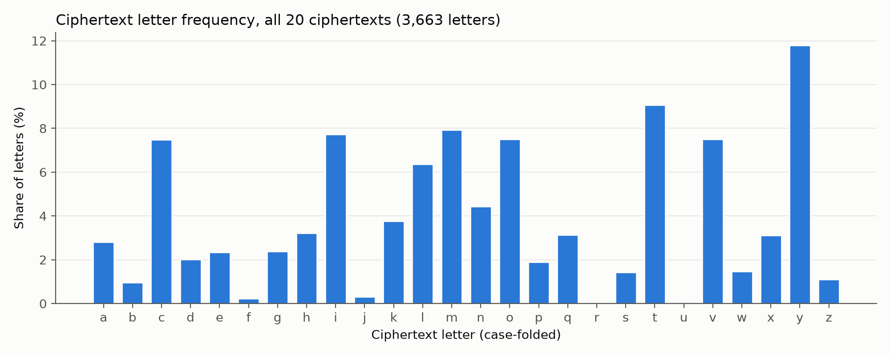
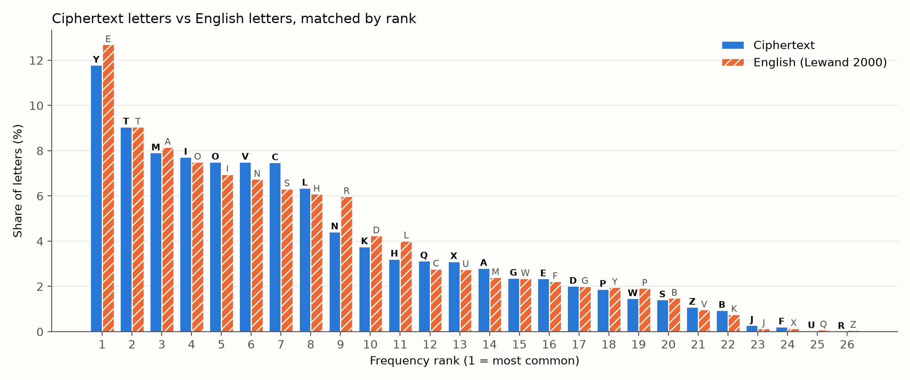

# 3. Al-Kindi Classical Cryptanalysis

## 3.1 Frequency analysis

Everything in this section is derived from the intercepted ciphertext alone (`ciphertexts.csv`). It is
reproduced by `task freq`, which runs `scripts/frequency/count.py`, `patterns.py` and `plot.py`.

### 3.1.1 The alphabet and modulus

Before counting, we establish which characters the cipher actually transforms. The capture shows:

- **Only letters change.** Digits pass through untouched: the usernames arrive as `tyctyl01` … `tyctyl05`,
  keeping `01` … `05`. Spaces, commas, full stops, apostrophes (`amk'ly`, `ot'c`), colons and the JSON
  newline escapes (`\n\n`) are all unchanged.
- **Case is preserved.** Sentence-initial capitals stay capitals (`Ot cmkvhc…`, `Tyctyl02, ot…`), and the
  standalone capital `O` appears where English has the one-letter word *I*.
- **Word lengths are preserved.** Every ciphertext has exactly the length of its plaintext field (for
  example the five concerns are 208, 184, 155, 173 and 159 characters, the same as the test inputs).

So the cipher maps the 26 letters onto themselves and leaves everything else alone: the alphabet is
A–Z with **modulus m = 26**, applied the same way to upper and lower case. All counts below fold case
and ignore non-letters.

### 3.1.2 Letter frequency tables

3,663 ciphertext letters were counted: 775 client→server (usernames, moods, concerns) and 2,888
server→client (the five LLM replies). Full tables: `report/figures/freq_table.csv`,
`freq_table_client_to_server.csv`, `freq_table_server_to_client.csv` (columns symbol, count, percent,
rank; the script asserts each table sums to 100 %).

| Rank | Cipher letter | Count | Cipher % | English letter (rank) | English % |
| --- | --- | --- | --- | --- | --- |
| 1 | y | 432 | 11.79 | e | 12.70 |
| 2 | t | 332 | 9.06 | t | 9.06 |
| 3 | m | 290 | 7.92 | a | 8.17 |
| 4 | i | 283 | 7.73 | o | 7.51 |
| 5 | o | 275 | 7.51 | i | 6.97 |
| 6 | v | 275 | 7.51 | n | 6.75 |
| 7 | c | 274 | 7.48 | s | 6.33 |
| 8 | l | 233 | 6.36 | h | 6.09 |
| 9 | n | 162 | 4.42 | r | 5.99 |
| 10 | k | 138 | 3.77 | d | 4.25 |
| 11 | h | 118 | 3.22 | l | 4.03 |

English frequencies: R. E. Lewand, *Cryptological Mathematics*, Mathematical Association of America, 2000.
The full 26-row pairing is in `report/figures/candidate_mapping.csv`.

Per direction, the top letter is the same:

| Direction | Letters | Top 8 cipher letters (%) |
| --- | --- | --- |
| client→server | 775 | y 13.5, v 9.9, t 9.2, o 8.5, i 8.0, m 6.7, l 5.2, c 4.5 |
| server→client | 2,888 | y 11.3, t 9.0, c 8.3, m 8.2, i 7.7, o 7.2, v 6.9, l 6.7 |





### 3.1.3 Why this is a monoalphabetic substitution

1. **Same shape, different labels.** Sorted by frequency (Figure 3.2), the ciphertext profile tracks the
   English profile closely: one dominant letter near 12 %, a block of six or seven letters between 6 % and
   9 %, then a long tail down to almost zero. Only the letter names differ. A polyalphabetic cipher
   (Vigenère, for example) would flatten this curve.
2. **Index of coincidence.** The probability that two randomly chosen letters are equal is unchanged by
   any one-to-one letter substitution:

   | Text | IC |
   | --- | --- |
   | All ciphertext | 0.0647 |
   | client→server | 0.0681 |
   | server→client | 0.0646 |
   | English (from the Lewand table) | 0.0655 |
   | Uniformly random letters | 0.0385 |

   The ciphertext sits on the English value, far from random. Each plaintext letter therefore always
   becomes the same ciphertext letter: exactly the behaviour of an affine cipher E(x) = (a·x + b) mod 26.
3. **Repetition survives.** Identical plaintext produces identical ciphertext (next section), which a
   cipher with a changing key would not do.

### 3.1.4 Structural patterns (the LLM gives itself away)

From `report/figures/patterns.md`:

| Pattern | Ciphertext | Count | Most likely plaintext |
| --- | --- | --- | --- |
| Most common word | `ivh` | 33 | *and* |
| Most common trigram | `ovg` (mostly word-final) | 48 | *ing* |
| Common bigram / trigram | `tx`, `txy` | 59, 15 | *th*, *the* |
| One-letter words | `i`, `o` (capital `O`) | 28, 18 | *a*, *I* |
| Frequent 3- and 4-letter words | `amk`, `amkl`, `pml` | 14, 19, 13 | *you*, *your*, *for* |
| Letter after an apostrophe | `c` in `ot'c`, `t` in `hmv't` | 11, 1 | *s* (*it's*), *t* (*don't*) |

The strongest structural clue is a **118-character block shared by all five replies**, always at the very end:

```
Txoc oc vmt i ckzctotkty pml dlmpyccomvin xynd. Op amk ily ov qlococ, dnyicy qmvtiqt amkl nmqin yeylgyvqa cylboqyc.
```

Fixed boilerplate repeated across sessions is exactly the weakness the brief describes: LLM output ends in
predictable disclaimers. Its word shapes (4-2-3-1-10-3-12-4, then a conditional *If you are in …*) give a
long known-plaintext crib to confirm any key guess.

### 3.1.5 Candidate mapping for key recovery

Rank matching alone (Figure 3.2) is only a starting point: ranks 3 to 7 are within about 0.5 % of each other,
so their order is noise. Combining frequency with structure gives the pairs we trust most:

| Cipher | → Plain | Evidence |
| --- | --- | --- |
| y | e | Rank 1 in every direction (11.8 %), and the last letter of `txy` (*the*) |
| t | t | Rank 2 (9.06 % vs English 9.06 %), first letter of `txy` and `txit` (*that*) |
| x | h | Second letter of `txy`, `tx` the third most common bigram |
| i | a | One-letter word `i`, first letter of `ivh` (*and*) |
| v | n | Middle of `ivh`, and of `ovg` (*ing*) |
| h | d | Last letter of `ivh` |
| o | i | Capital `O` alone is the pronoun *I*; first letter of `ovg` |
| g | g | Last letter of `ovg` |
| m | o | Middle of `amk` (*you*) and `pml` (*for*), `tm` (*to*) 30 times |

The two highest-confidence pairs, **y → e** (most frequent letter) and **t → t** (second most frequent,
confirmed by *the*), are taken forward to Section 3.2, where they give two linear equations in a and b.
Every other pair above then serves as an independent check on the recovered key.
